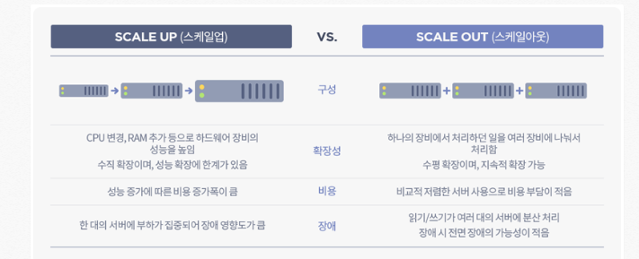

### Scale up

- Scale Up은 기존 서버의 사양을 업그레이드해 시스템을 확장하는 것을 말한다.
  CPU나 렘 등을 추가하거나 고성능의 부품, 서버로 교환하는 방법이다.
  이처럼 하나의 서버의 사양을 업그레이드 하기 때문에 수직스케일로 불리기도 한다.

### Scale out
- 스케일 아웃은 서버를 여러대 추가하여 시스템을 ㅎ확장하는 것을 말한다.
서버가 여러 대로 나뉘기 때문에 각 서버에 걸리는 부하를 균등하게 해주는 로드밸런싱이 필수적으로 동반되어야 한다.
이처럼 여러대의 서버로 나눠 시스템을 확장하기 때문에 수평스케일로 불리기도 한다.

