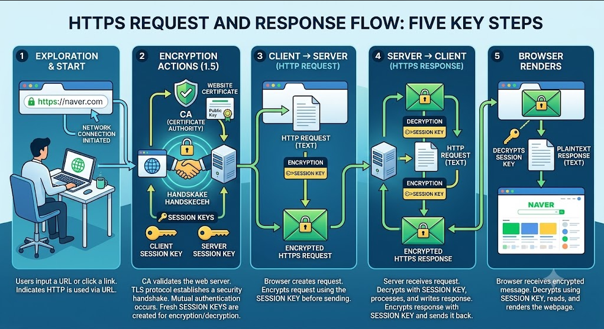
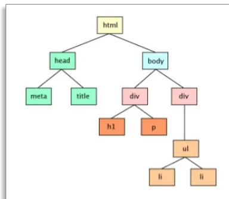
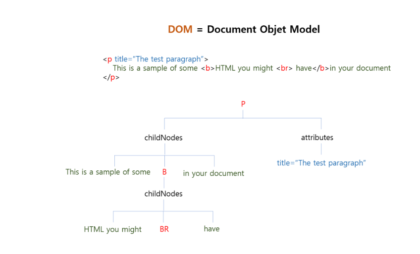

# 0주차

# 기술과제

## https://youtu.be/SRi4chNDEbY

### 목표: 각 개념에 대한 3줄 요약

1. 웹브라우저가 무엇인지?
  -초창기-단순한 텍스트,이미지,버튼-정적데이터 표시
  -사용자가 인터넷에서 웹페이지, 이미지, 동영상 등의 콘텐츠를 검색하고 화면에 표시할 수
   있도록 해주는 응용 프로그램
  -웹브라우저-구글 크롬, 애플 사파리, 마이크로소프트 엣지

2. 서버가 무엇인지?
-서버(server)-service+er(웨이터)(서비스를 제공=서버)
-PC는 서버와 클라이언트 둘다 사용 가능하다.

3. 클라이언트가 무엇인지?
-클라이언트(Client)(손님)서버에게 서비스를 제공받으면 클라이언트
-Chrome에 네이버 웹서버에 요청->HTML(웹사이트 정적데이터에 사용하는 언어)을 클라이언트에
 전달 
 
4. IP, DNS, Domain, PORT가 무엇인지?
-IP=PC의 집주소=주로 IPV4
-Domain=IP의 별명
-DNS 서버=도메인과<->IP주소를 매칭해주는 서버
-포트=서비스 번호(PC를 건물로 비유했을 때 각 층은 서비스, 서비스는 번호가 있다.
                사용자는 서비스를 이용하려면 번호표(포트)를 뽑아야 갈 수 있다.)

(Trial: cmd터미널- nslookup naver.com -  IP주소를 입력해도 안나옴-강의와 내용 다름
Solution: 터미널(cmd)이든 브라우저든 'IP 주소 숫자만' 덩그러니 사용해서 완전한 네이버 웹페이지를 띄우는 것은 불가능
Alternate Solution: curl -H "Host: www.naver.com" http://223.130.200.236
명령어를 입력함으로써 터미널에서 서버와 통신완료)

5. 네트워크가 무엇인지?
 -서로 pc끼리 통신이 가능하면 네트워크다
 -컴퓨터,스마트폰 등 다양한 기기들을 그물망처럼 연결하여 정보와 데이터를 주고받을 수 있는 통신망
 
6. 공유기가 무엇인지?
-하나의 네트워크 망을 만드는 기기
-네트워크-대화가가능함
-공유기=대화가 가능하게 만드는 기기

7. HTTPS가 무엇인지?
-Hyper text transfer protocol+secure
-웹사이트안의 데이터가 브라우저와 웹서버가 암호화 되는 과정을 수행.
-https 흐름의 단계: 탐색-암호화동작-클라이언트 서버로 http요청 메세지 전송-
웹서버 https응답을 클라이언트로 다시 전송-브라우저에서 메세지 렌더링

8. **DOM이란 무엇인가? ( 영상에서 언급이 없지만, 본인이 AI사용을 하든 뭘 하든간에 본인의 방식가지고 최대한 이해해서 설명해보기 - 쉽지 않은게 정상 )**
-DOM(Document Object Model(문서 객체 모델))은 넓은의미로는 브라우저가 HTML을 인식하는 방식, 좁은 의미로는 문서의 객체와 관련된 집합(구조?)를 의미한다.
 
 -DOM은 부모와 자식 노드로 나누어져있다.
  (위 이미지로 예를 든다면 HEAD는 부모, META, TITLE은 자식 노드이다.)
 
 (추가 설명 Node:  tree 구조에서 root 노드를 포함한 모든 개개의 개체를 node라고 표현. head, body, title, script, h1, HEADER-1 등의 태그뿐 아니라 태그 안의 텍스트나 속성 등도 모두 node에 속함.)

9. 브라우저 렌더링 과정
-렌더링이란 HTML, CSS, Javascript등 개발자가 작성한 문서를 브라우저에서 그래픽 형태로 출력하는 과정
-렌더링 과정: DOM,CSSOM(CSS Object Model)->Render Tree 생성->Layout(Reflow)생성->Paint
->Reflow,Repaint(기존 액션이나 이벤트에 따라 html 요소의 크기나 위치등 레이아웃 쉬를 수정하면 그에 영향을 받는 자식,부모노드들을 포함하여 Layout 과정을 다시 수행)

# 코드과제

- 영상에 나오는 내용 공부해서 안보고 스스로 HTML/CSS소스코드 만들어보기
    - 완벽하게 만드는건 중요하지 않다 → 사용하고 고민해보는게 목적

### TIP

1. 외우지 말자
    1. 인식하는게 중요
        1. 내가 필요 할 때 검색 해서 가져다 쓰면 된다.
        2. 많이 사용하다보면 외워짐을 당한다.