# CSS 기초

## 시맨틱 태그란?

시맨틱(Sementic)-정의: 의미의,의미론적인
 - 시맨틱 태그는 HTML 구조를 설계하는데 있어 태그에 의미를 부여함으로써 웹사이트의 구조를
   파악하기 쉽도록 도와주기 위해 만들어진 것이다.
   
## < div > 태그
< div >는 'Division'의 약자로, 특별한 의미 없이 콘텐츠를 묶거나 레이아웃을 나눌 때 사용하는 범용적인 컨테이너이다.

  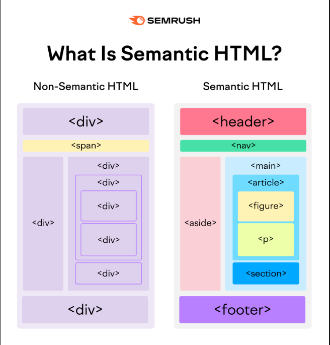

## 시맨틱 vs < div > 태그 각 태그들의 장단점

### < div > 태그

장점:

- 무한한 범용성과 유연성: 태그 자체에 의미가 없기 때문에, CSS로 디자인을 입히기 위한 단순한  요소들을 그룹화하는 용도로 어디에나 부담 없이 사용할 수 있다.

- 백지상태의 스타일: 브라우저가 기본적으로 부여하는 특별한 의미나 기본 스타일이 없어서,
개발자가 의도한 대로 CSS 레이아웃을 순수하게 구현하기에 가장 편하다.

- 빠른 레이아웃 구성: 의미론적 구조를 깊게 고민할 필요 없이, 빠르게 화면의 영역을 분할하고 뼈대를 잡을 때 유용하다.

단점:

- 의미의 부재: 태그 이름만으로는 그 안에 어떤 내용이 들어있는지(메뉴인지, 본문인지 등) 전혀 파악할 수 없다.

- Div Soup (코드 복잡도 증가): 복잡한 레이아웃을 짤 때 < div > 안에 < div >가 무한정 중첩되면, 코드를 읽고 유지보수하기가 매우 힘들어진다.

- SEO 및 접근성 취약: 검색 엔진이나 스크린 리더 기기가 페이지 내에서 무엇이 중요한 핵심 콘텐츠인지 식별하는 데 도움을 주지 못한다.

### 시맨틱 태그 (Semantic HTML)
< header >, < main >, < article >, < nav > 등 이름 자체에 뚜렷한 의미와 역할을 담고 있는 태그이다.

장점:

- 검색 엔진 최적화: 검색 엔진이 웹 문서의 구조를 쉽게 파악하여 중요한 콘텐츠를 우선적으로 수집하고 검색 결과에 반영할 수 있도록 돕는다.

- 웹 접근성 향상: 시각 장애인용 스크린 리더 등의 보조 기기가 문서의 주요 영역을 인식하고 건너뛰기 기능을 제공하는 등 탐색에 결정적인 역할을 합니다.

- 높은 코드 가독성: < header >, < footer > 등 태그 이름만으로도 레이아웃의 역할을 즉각적으로 알 수 있어, 개발자 간의 협업과 추후 유지보수가 훨씬 수월해집니다.

단점:

- 적절한 태그 선택의 어려움: 상황에 딱 맞는 의미의 태그를 선택해야 하므로, 초기 설계 시 < div >만 쓸 때보다 웹 표준에 대한 사전학습과 판단력이 필요하다. (예: < article >을 쓸지 < section >을 쓸지에 대한 구분)

잘못 사용 시 부작용: 의미에 맞지 않는 시맨틱 태그를 남용하거나 오용하면, 오히려 스크린 리더가 사용자에게 잘못된 정보를 전달하거나 검색 엔진 로봇에 혼란을 줄 수 있다.

기본 스타일 존재: 일부 시맨틱 태그나 관련 요소들은 브라우저에 따라 기본적인 여백이 적용되어 있을 수 있기 때문에, CSS 초기화 작업에 신경을 써야 할 때가 있다.

# JS 기초
## 1. 자바스크립트 기본 문법 이해하기 (변수생성,if,for,while,function,array,object 등)

#### -variable: 데이터를 담는 '이름 붙은 상자'
- let: 내용물을 언제든지 다른 것으로 바꿀 수 있는 상자이다.

- const: 한 번 내용물을 넣으면 테이프로 밀봉해서 절대 바꿀 수 없는 상자이다.

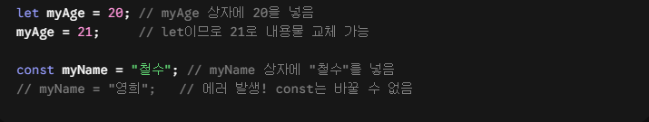

#### - if: 상황에 따른 '갈림길'
- if문은 특정 조건이 참(True)인지 거짓(False)인지에 따라 컴퓨터가 다른 행동을 하도록 지시하는 문법입니다. "만약 비가 오면 우산을 쓰고, 아니면 그냥 간다"와 같은 논리다.

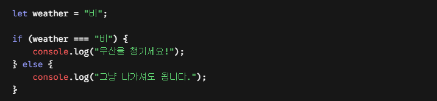

#### - for & while: 단순 반복 작업의 달인
- 코드를 수십, 수백 번 똑같이 쳐야 할 때 사용하는 문법이다.

- for (횟수가 정해져 있을 때): "딱 5번만 점프해!"처럼 반복할 횟수가 명확할 때 쓰인다.

- while (조건이 중요할 때): "배가 부를 때까지 계속 먹어!"처럼 특정 조건이 끝날 때까지 무한정 반복할 때 쓰인다.

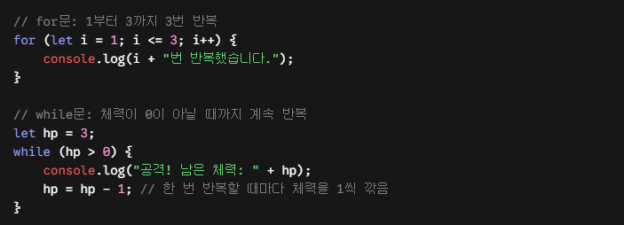

#### - function: 재료를 넣으면 결과를 내는 '자판기'
- 함수는 자주 사용하는 코드들을 하나로 묶어둔 '작업 지시서' 혹은 '자판기'이다. 동전을 넣고 버튼을 누르면 음료수가 나오는 것처럼, 재료를 넣어주면 정해진 작업을 수행하고 결과를 돌려준다.
Math.floor()도 이미 만들어져 있는 함수이다.

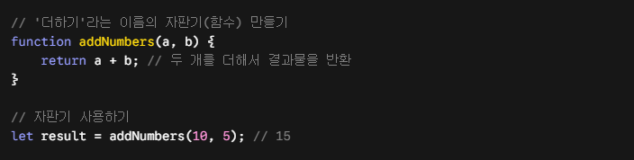

#### -array-순서대로 번호표가 붙은 '사물함'
- 하나의 상자(변수)에 여러 개의 데이터를 순서대로 줄 세워 보관하고 싶을 때 사용합니다. 배열 안의 데이터들은 0번부터 시작하는 번호표(인덱스)를 자동으로 부여받는다. 대괄호 []를 사용.

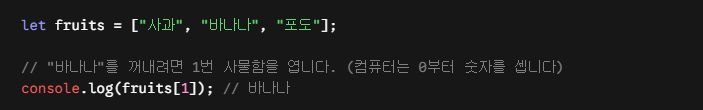

#### -object: 이름표가 붙어 있는 '상세 정보 사전'
- 배열이 단순히 순서대로 물건을 넣는 것이라면, 객체는 각 데이터에 '이름표(Key)'를 붙여서 관련된 정보를 한 덩어리로 묶어두는 패키지이다. 중괄호 {}를 사용한다.

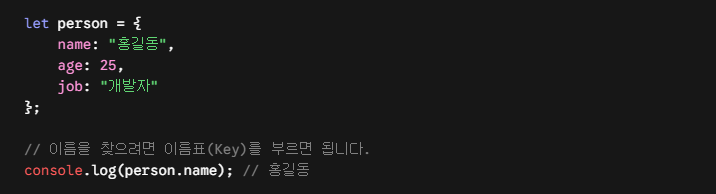

## 2. 자바스크립트 DOM 조작 이해하기 (querySelctor, get Element by id(by class)로 어떻게 조작하는지)

- JS에서 DOM 조작을 이해하는 가장 쉬운 방법은 웹 페이지(HTML)를 '집'이라고 생각하고, 그 안에 있는 요소들(버튼, 텍스트, 이미지 등)을 '가구'라고 상상하는 것이다.

- DOM 조작이란 결국 집 안에서 원하는 가구를 찾아내서, 색깔이나 위치를 바꾸는 과정이다.

## -DOM 조작법 단계별로 이해해보기-

# 1) 원하는 요소 찾기 (Select)

- 자바스크립트가 HTML 요소에 접근하려면 먼저 요소를 찾아내야 한다. 이때 주로 세 가지 방법을 사용한다.

### 1. document.getElementById('아이디이름')

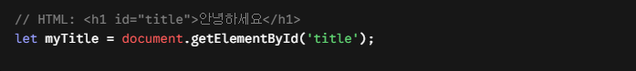

- 특징: HTML에 부여된 고유한 id 값으로 요소를 단 하나만 정확하게 찾는다.

- 비유: "주민등록번호가 123456인 사람 찾아와!" (세상에 하나뿐이므로 가장 빠르고 확실한 방법)

### 2. document.getElementsByClassName('클래스이름')

- 특징: 같은 class 이름을 가진 요소들을 모두 찾아옵니다. 결과가 1개든 100개든 무조건 배열과 비슷한 '목록' 형태로 가져온다.

비유: "빨간색 티셔츠(class) 입은 사람들 다 모여!
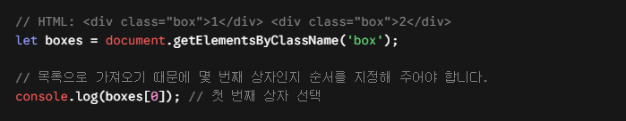

### 3. document.querySelector('CSS선택자') (가장 많이 씀)

- 특징: CSS에서 스타일을 줄 때 사용하는 문법(.클래스, #아이디, 태그명)을 그대로 사용해서 요소를 찾는다. 아주 유연하고 편리해서 현대 자바스크립트에서 가장 널리 쓰인다.

- 주의점: 조건에 맞는 요소가 여러 개 있어도 무조건 맨 처음에 발견된 1개만 가져온다.(모두 찾으려면 querySelectorAll을 사용한다.)

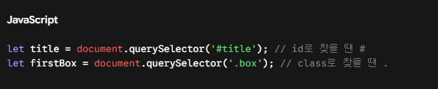

# 2단계: 찾은 요소 조작하기 (Manipulate)
- 원하는 요소를 변수에 찾았다면, 이제 그 요소의 속성을 마음대로 바꿀 수 있다.

### 1. 글자 내용 바꾸기 (textContent, innerHTML)

- 찾아낸 요소 안에 들어있는 텍스트나 HTML 구조를 통째로 바꿀 수 있다.
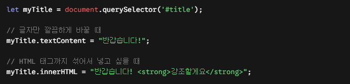

### 2. 디자인(CSS) 직접 바꾸기 (style)
- 자바스크립트로 CSS 스타일을 직접 조작할 수 있다.

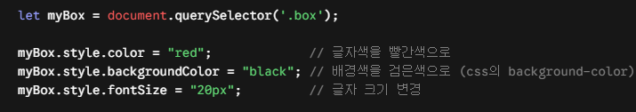

### 3. 클래스 추가/제거하기 (classList)
- 직접 스타일을 하나씩 바꾸는 것보다, 미리 CSS에 .active 같은 디자인을 만들어 두고 JS로는 클래스 이름만 뗐다 붙였다 하는 방식이 실무에서 훨씬 많이 쓰인다.

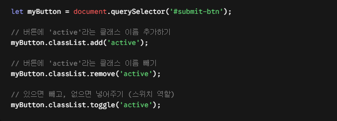

