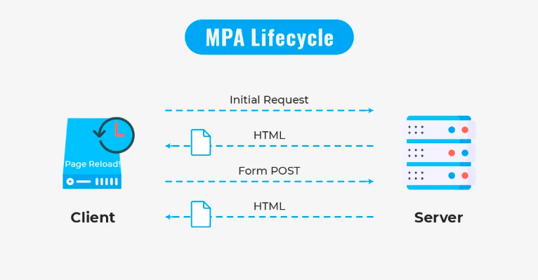
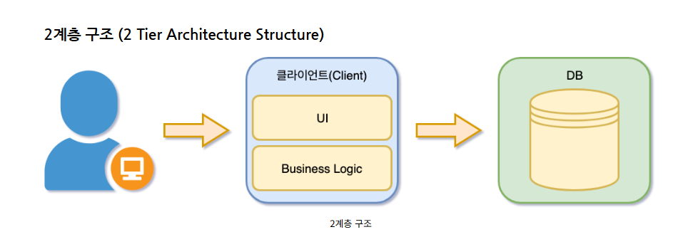
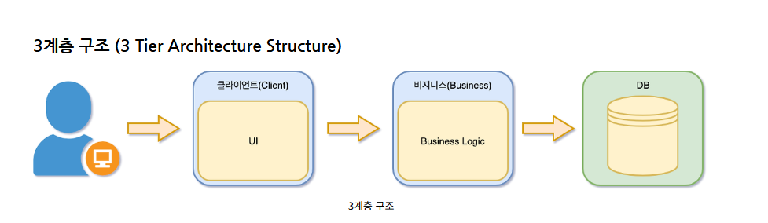
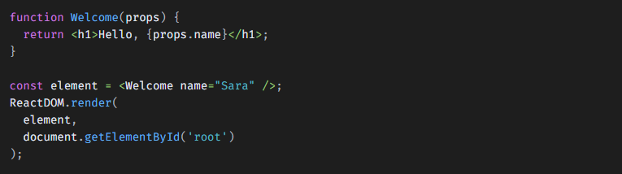
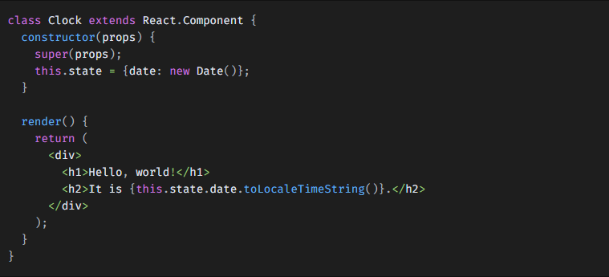

- ## SPA란 무엇인가 ?, MPA란 무엇인가?
# SPA(Single page Application)

## 개념

- (그림참고) SPA는 웹 에플리케이션에 필요한 모든 정적 리소스를 최초 접근 시 단 한번만 다운로드한다. 이후 새로운 페이지 요청 시, 페이지 갱신에 필요한 데이터만을 JSON으로 전달받아 페이지를 갱신한다. 기존 페이지의 내부를 수정해서 보여주는 방식이다.

- 서버로부터 완전한 새로운 페이지를 불러오지 않고 현재의 페이지를 동적으로 다시 작성함으로써 사용자와 소통하는 웹 애플리케이션이나 웹사이트를 말한다.

- SPA를 일반적으로 CSR(Client Side Rendering) 방식으로 렌더링한다고 말한다.
이렇기 때문에 서버가 해야 할 역할을 클라이언트 부담하므로, 서버 부담이 경감된다.

## SPA의 장점

- 속도 및 응답시간
속도는 전반적인 사용자 경험을 향상시키는 데 중요한 요소이다.
전체 페이지를 다시 렌더링하지 않고 변경되는 부분만을 갱신하므로 새로고침이 발생하지 않아 네이티브 앱과 유사한 사용자 경험을 제공할 수 있다.

- 모바일 친화적
모바일 앱도 SPA와 동일한 아키텍처에서 개발되므로 모바일 개발을 염두해두면 동일한 백엔드 코드를 재사용하도록 할 수 있다.

- 개발 간소화
서버에서 페이지를 렌더링하기 위해 코드를 작성할 필요가 없다.SPA는 보다 "현대적인" 것으로 간주되며 오늘날의 민첩한 개발 요구 사항에 적합하다.

## SPA의 단점

- 초기 구동 속도
SPA는 웹 애플리케이션에 필요한 모든 정적 리소스를 최초 접근시 단 한번 다운로드하기 때문에 초기 구동 속도가 상대적으로 느리다.

- SEO(검색엔진 최적화) 이슈
SPA는 JavaScript로 구축된다.(CSR 방식) 자바스크립트를 읽지 못하는 검색엔진에 대해서 크롤링이 되지않아 색인이 되지 않는 문제가 발생할 수 있다.

- 보안 문제
XSS(교차 사이트 스크립팅)로 인해 공격자가 다른 사용자가 웹 응용 프로그램에 클라이언트 측 스크립트를 삽입할 수 있는 위험이 있다.

- # MPA(Multiple Page Application)

## 개념

- (그림참고)새로운 페이지를 요청할 때마다 서버에서 렌더링된 정적 리소스(HTML, CSS, JavaScript)가 다운로드된다.
- MPA는 SSR(Server Side Application) 방식으로 렌더링한다.
새로운 페이지를 요청할 때마다 서버에서 렌더링된 정적 리소스(HTML, CSS, JavaScript)가 다운로드된다.
- 페이지를 이동하거나 새로고침하면 전체 페이지를 다시 렌더링한다.

## MPA의 장점
- SEO(Server Engine Optimization) 친화적
MPA를 사용하여 여러 페이지를 생성할 수 있기 때문에 훨씬 더 많은 수의 키워드를 타겟팅할 수 있다. 이렇게 하면 Google에서 얻을 수 있는 유기적 트래픽의 양이 자동으로 향상된다. 더 많은 페이지로 인해 여러 HTML 파일이 존재하는데, HTML 다운로드하여 페이지를 크롤링하기 때문에 검색 엔진이 작동하는 방식에 더 적합하다.

- 확장성
다중 페이지로 원하는 만큼 페이지를 추가할 수 있다. (ex. Amazon 플랫폼에서 사용할 수 있는 제품의 수는 원하는 만큼 콘텐츠를 추가)

## MPA의 단점

- 페이지 이동 시 느린 속도
사용자가 새로운 페이지를 이동하면 전체 페이지를 다시 렌더링하기 때문이다. HTML, CSS, JS 와 같은 리소스들이 새로 고쳐져서 속도에 영향을 받는다.

- 복잡한 개발
개발자는 클라이언트 측과 서버 측 모두에 프레임워크를 사용해야 합니다. 그 결과 애플리케이션 개발 시간이 더 길어진다.

- 보안 및 유지보수
개발자는 모든 페이지가 안전한지 확인 해야하는데 페이지가 많아서 지속적으로 유지보수 하는 것이 어려움.

- ## 추가 내용 2계층 구조 VS 3계층 구조

- 과거 대부분의 웹사이트는 2계층 구조로 개발되어있다. 2계층 구조란, 화면이 보여지는 클라이언트(Client)와 데이터베이스(DB)가 물리적으로 분리되어 있는 것을 뜻하며, 클라이언트에는 UI (User Interface)와 비즈니스 로직Business Logic이 함께 있는 구조다.

- 비교적 쉽고 빠르게 개발할 수 있고, 애플리케이션 구조가 단순하여 초기 서비스나 웹사이트들이 많이 사용하는 구조다. 다만 클라이언트 속도 문제, 비즈니스가 복잡해지거나 비대해지면 관리하기가 어려워져서 차후에 3계층, 혹은 N계층 구조로 재설계하여 리뉴얼하기도 한다.

- 2계층 구조와 3계층 구조의 가장 큰 차이점은 클라이언트 안에 있는 비즈니스 로직이 분리된다는 점이다. 클라이언트는 프레젠테이션, 비즈니스는 애플리케이션이라고 부르기도 한다. 3계층 구조로 설계하게 되면서 클라이언트는 프론트엔드 개발자가, 비즈니스 로직은 백엔드 개발자가 담당하게 되어 역할 분담이 이루어진다.

- 가장 큰 장점으로 UI와 비즈니스 로직이 분리되어 있어 애플리케이션을 배포할 때 UI와 비즈니스 로직을 각각 배포할 수 있다는 점이다.

- ## React란 무엇인가 ?
- React는 웹 프레임워크로, 자바스크립트 라이브러리의 하나로서 사용자 인터페이스를 만들기 위해 사용된다.

- React는 facebook에서 제공해주는 프론트엔드 라이브러리라고 볼 수 있다.
싱글 페이지 애플리케이션이나 모바일 애플리케이션의 개발 시 토대로 사용될 수 있다.
즉, 현재 많이 활용되고 있는, 웹/앱의 View를 개발할 수 있도록 하는 인기있는 라이브러리라고 볼 수 있다.

### React의 필요성
- react를 사용하지 않아도, html과 css, javascript를 이용해서 웹 페이지를 만들 수 있지만, react를 이용해 사용자와 상호작용할 수 있는 동적인 UI를 쉽게 만들 수 있기 때문에 많이 이용됨.

### React의 특징
React의 특징은 크게 다음과 같이 구분함.
1. Data Flow
2. Component 기반 구조
3. Virtual Dom
4. Props and State
5. JSX

#### 1. Data Flow
React는 데이터의 흐름이 한 방향으로만 흐르는 단방향 데이터 흐름을 가진다.

Augular.js와 같은 양방향 데이터 바인딩은 규모가 커질수록(대규모 애플리케이션의 경우) 데이터의 흐름을 추적하기가 힘들고 복잡해지는 경향이 있어, 복잡한 앱에서도 데이터 흐름에서 일어나는 변화를 보다 예측 가능할 수 있도록 단방향 흐름을 가지도록 했다고 한다.

#### 2. Component 기반 구조
Component는 독립적인 단위의 소프트웨어 모듈을 말한다.
즉, 소프트웨어를 독립적인 하나의 부품으로 만드는 방법이라고 볼 수 있다.

React는 UI(View)를 여러 컴포넌트(component)를 쪼개서 만듭니다.
한 페이지 내에서도 여러 각 부분을 독립된 컴포넌트로 만들고, 이 컴포넌트를 조립해 화면을 구성한다.

컴포넌트 단위로 쪼개져 있기 때문에, 전체 코드를 파악하기가 상대적으로 쉽습니다. 이렇게 기능 단위, UI 단위로 캡슐화시켜 코드를 관리하기 때문에 재사용성이 높습니다. 따라서 코드는 반복해 입력할 필요 없이, 컴포넌트만 import해 사용하면 된다는 간편함이 있으며, 애플리케이션이 복잡해지더라도 코드의 유지보수, 관리가 용이해지는 장점을 가진다.

#### Addendum: 컴포넌트란?

##### 1. 완벽하게 독립적인 '하나의 세트'
과거에는 버튼 하나를 만들더라도 뼈대(HTML) 파일, 디자인(CSS) 파일, 동작(자바스크립트) 파일을 각각 따로따로 관리해야 했음.

하지만 컴포넌트는 '버튼의 생김새 + 색상 + 클릭했을 때의 동작'을 하나의 레고 블록(파일) 안에 전부 세트로 묶어둡니다. 덕분에 블록 하나만 툭 떼어내서 어디든 쉽게 가져다 놓을 수 있다.

##### 2. 무한한 재사용성 (복사 붙여넣기의 진화)
- 쇼핑몰 웹사이트를 보면 똑같이 생긴 '상품 사진 + 가격 + 장바구니 버튼' 형태가 수십 개씩 나열되어 있음.

- 이것을 매번 새로 코딩하는 것은 엄청난 낭비. 대신 '상품 카드'라는 컴포넌트를 딱 하나만 예쁘게 만들어 둠. 그리고 화면에 이 컴포넌트를 100번 불러오기만 하면, 안에 들어가는 데이터(사진, 가격)만 바꿔서 똑같은 틀을 100개 무한정 찍어낼 수 있음. 붕어빵 틀과 같은 원리.

##### 3. 압도적으로 편리한 유지보수
- 만약 웹사이트 전체에 500개의 '좋아요' 버튼이 흩어져 있는데, 사장님이 갑자기 "좋아요 버튼 색깔을 파란색에서 빨간색으로 다 바꿔주세요!"라고 지시했다고 가정.

- 컴포넌트가 없을 때: 500개의 코드를 일일이 찾아다니며 파란색을 빨간색으로 고쳐야 함.

- 컴포넌트가 있을 때: 원본인 '좋아요 버튼' 레고 블록 딱 한 곳만 열어서 색깔을 빨간색으로 바꿈. 그러면 이 블록을 가져다 쓴 500곳의 색깔이 1초 만에 동시에 바뀜.

### 3. Virtual DOM
- DOM은 Document Object Model의 약자.
DOM은 html, xml, CSS 등을 트리 구조로 인식하고, 데이터를 객체로 간주하고 관리.

- React는 이 DOM Tree 구조와 같은 구조체를 Virtual DOM으로 가지고 있습니다.

- Virtual DOM은 말그대로 가상의 Document Object Model을 말함.

- 이벤트가 발생할 때마다 Virtual DOM을 만들고, 다시 그릴 때마다 실제 DOM과 비교하고 전후 상태를 비교해, 변경이 필요한 최소한의 변경사항만 실제 DOM에 반영해, 앱의 효율성과 속도를 개선할 수 있다고 함.

### 4. Props and State
#### Props
Props란 부모 컴포넌트에서 자식 컴포넌트로 전달해 주는 데이터를 말함.
쉽게 읽기 전용 데이터라고 생각하면 편하다. 자식 컴포넌트에서 전달받은 props는 변경이 불가능하고 props를 전달해준 최상위 부모 컴포넌트만 props를 변경할 수 있다.

- 위의 코드를 보면 element에 Welcome을 담고 있음. Welcome은 부모인 element에 있는 Sara를 props에 담아 내려받고 사용하고 있음.

#### State
- State는 컴포넌트 내부에서 선언하며 내부에서 값을 변경할 수 있다. state는 동적인 데이터를 다룰 때 사용하며, 사용자와의 상호작용을 통해 데이터를 동적으로 변경할 때 사용함. 클래스형 컴포넌트에서만 사용할 수 있고, 각각의 state는 독립적이다.

- 위의 코드를 보면 시간이 변할 때 마다 화면을 업데이트해 주는 코드를 볼 수 있다.
이때 시간은 계속해서 변하는 상태 값이기 때문에 state 객체 안에 넣어줌으로써 상태를 관리할 수 있다. 이 외에도 onclick 이벤트의 클릭 정보를 저장하거나 하는 등의 방식으로 state를 사용하여 좀 더 많은 기능을 페이지에 추가할 수 있다.

### 5. JSX
- React에서 JSX 사용이 필수는 아니지만, React에서 사용됨.

- const element = <h 1>Hello, world!</h 1>;

- 위와 같은 변수 선언도 JSX문법이다.

#### JSX란 ?

- Javascript를 확장한 문법.

- React에서는 이벤트가 처리되는 방식, 시간에 따라 state가 변하는 방식, 화면에 표시하기 위해 데이터가 준비되는 방식 등 렌더링 로직이 본질적으로 다른 UI 로직과 연결된다는 사실을 받아들임.

- React는 별도의 파일에 마크업과 로직을 넣어 기술을 인위적으로 분리하는 대신, 둘 다 포함하는 “컴포넌트”라고 부르는 느슨하게 연결된 유닛으로 관심사를 분리. 이후 섹션에서 다시 컴포넌트로 돌아오겠지만, JS에 마크업을 넣는 게 익숙해지지 않는다면 이 이야기가 확신을 줄 것임.
(여기서 마크업은 사용자에게 '무엇을 보여줄 지' 결정하는 시각적인 뼈대와 구조를 말함.)
(예시: < div > < button > < h1 >)

- React는 JSX 사용이 필수가 아니지만, 대부분의 사람은 JavaScript 코드 안에서 UI 관련 작업을 할 때 시각적으로 더 도움이 된다고 생각합니다. 또한 React가 더욱 도움이 되는 에러 및 경고 메시지를 표시할 수 있게 해줍니다.
React 공식문서

- ### 리액트 프로젝트 만들어보기 - 거기서 간단하게 그냥 컴포넌트 몇개 생성해서 페이지 만들어보기

http://localhost:5173/