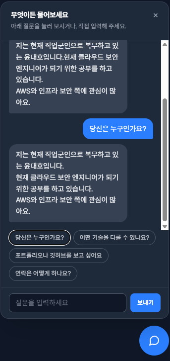
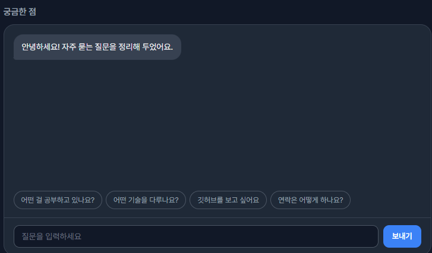

- 클로드 셋팅하고, 본인 코드 github 저장소에 올려보기
- https://github.com/Leovevo/my-portfolio
- 채팅창 레이아웃 만들어보기
    - 클로드 vscode 사용법 검색 - 유튜브
    -기존 레이아웃:
    
   -변경 레이아웃: 

 - # Vercel이 무엇인지 ?
    - vercel에 github에 올린 포트폴리오 웹사이트 배포
  -  https://my-portfolio1-umber-eta.vercel.app/
- 도메인을 구매 - 가비아,카페24 … 다양하게 많다 비교해보고 구매해보기

 - # 네임서버가 무엇인지?
- 네임 서버는 DNS라는 거대한 시스템 안에서 실제로 전화번호부가 적힌 장부를 들고 질문에 대답해 주는 '서버 컴퓨터'입니다.

- 우리가 웹 브라우저에 주소를 칠 때, 우리 컴퓨터가 "이 주소의 실제 IP가 뭐야?"라고 은밀하게 물어보는 대상이 바로 이 네임 서버입니다.

- 비유: 전화번호부 시스템 속에서 실제로 두꺼운 주소록을 뒤적거리며 "아, 그 웹사이트 번호는 192.168.X.X 입니다"라고 대답해 주는 '안내데스크 직원'이라고 볼 수 있습니다. (유형의 장비/소프트웨어)

- # DNS가 무엇인지?
- DNS는 우리가 github.com이나 google.com 같은 영문 주소(도메인)를 입력했을 때, 컴퓨터가 알아들을 수 있는 숫자로 된 IP 주소(예: 142.250.190.46)로 변환해 주는 '인터넷의 전화번호부 시스템 전체'를 말합니다.

비유: 사람의 이름(도메인)을 말하면 전화번호(IP)를 연결해 준다는 전체적인 체계, 서비스, 또는 통신 규칙 그 자체를 뜻합니다. (무형의 개념)
 
- 구매한 도메인을 vercel에 올린 내 포트폴리오 웹사이트에 연동
- https://www.myfortfolio.xyz/

## - 추가개념 -

- ### 레코드란?
- 📖 DNS가 '전화번호부 책'이라면, 레코드는 '그 안의 한 줄(명함)'입니다.
우리가 흔히 말하는 DNS(Domain Name System)는 인터넷의 거대한 전화번호부 시스템 전체를 의미합니다. 그리고 그 전화번호부 책 안을 들여다보면, "누구 = 몇 번"이라고 적혀있는 각각의 데이터 한 줄 한 줄이 바로 '레코드(Record)'입니다.

### - 레코드의 종류 -

1. A 레코드 (A Record, Address)

- 의미: 직통 전화번호입니다. 도메인(이름)을 컴퓨터의 실제 IP 주소(숫자)와 직접 1:1로 연결해 줍니다.

- 방금 한 작업에서: "myfortfolio.xyz로 전화가 오면, Vercel 서버의 직통 번호인 216.198.79.1로 바로 연결해 주세요"라는 명함을 전화번호부에 추가하신 것입니다.

2. CNAME 레코드 (Canonical Name)

의미: '착신 전환' 또는 '별명'입니다. IP 주소가 아니라, 또 다른 영문 주소로 토스(전달)해 주는 역할을 합니다.

방금 한 작업에서: 사람들이 앞에 www를 붙여서 www.myfortfolio.xyz라고 치면, 이것을 Vercel의 복잡한 영문 주소(7e6a5cd...)로 다시 넘겨서 찾아가도록 안내판을 세워두신 것입니다.

- #### 추가예시

3. TXT (Text) 레코드 - 보안 인증의 핵심: 도메인에 대한 '텍스트 메모'를 암호문처럼 남기는 공간입니다. 최근 보안 영역에서 가장 중요한 레코드로 꼽힙니다. 주로 구글이나 AWS 같은 서비스에 "이 도메인은 진짜 내 것이 맞다"고 소유권을 증명할 때 쓰이거나, 해커가 내 도메인 주소로 가짜 피싱 이메일을 보내지 못하도록 막는 이메일 방어 서명(SPF, DKIM, DMARC)을 기록하는 데 사용됩니다.

4. MX (Mail Exchange) 레코드 - 이메일 분류국: 이메일을 수신할 '우체국 서버'의 위치를 알려주는 레코드입니다. 누군가 @myfortfolio.xyz 주소로 메일을 보냈을 때, 그 메일 트래픽이 구글 워크스페이스 서버로 향할지 마이크로소프트 서버로 향할지 목적지를 지정해 줍니다.

5. AAAA (Quad A) 레코드 - 차세대 주소 연결: A 레코드의 차세대 버전입니다. A 레코드가 우리가 흔히 아는 IPv4 주소(예: 216.198.79.1)를 연결한다면, AAAA 레코드는 고갈되어 가는 IP를 대체하기 위해 나온 훨씬 더 길고 복잡한 최신 주소 체계인 IPv6 주소를 연결할 때 사용합니다.

6. NS (Name Server) 레코드 - 권한 위임장: 전화번호부의 '관리 권한'을 다른 곳에 넘겨줄 때 사용합니다. 예를 들어 "이 도메인의 주소록 관리는 이제 가비아가 아니라, Vercel이나 AWS Route 53 같은 글로벌 클라우드 네임 서버가 전적으로 알아서 할 거야!"라고 위임장을 써주는 역할입니다.