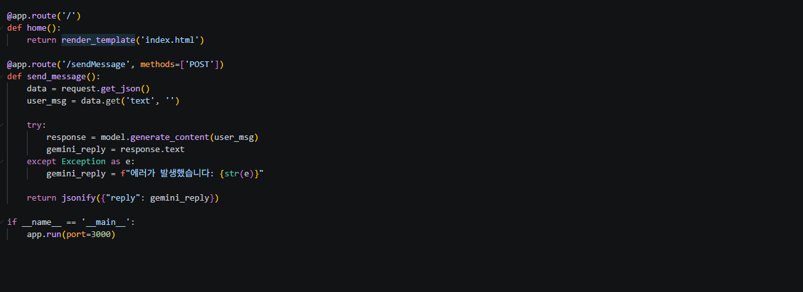

# 1. /sendmessage 란?

🏦 은행 창구 비유로 이해하는 /sendMessage
파이썬(Flask) 서버를 커다란 '은행 건물'이라고 상상해 보세요.
이 은행 건물(http://localhost:3000)에는 여러 개의 '문(경로, Route)'과 '창구'가 있습니다.

### 1. 기본 대문 (/) : 로비 안내 데스크

코드: @app.route('/')

사용자가 브라우저 주소창에 localhost:3000만 치고 들어오는 것은 은행의 정문(대문)으로 들어오는 것과 같습니다.

정문으로 들어온 손님에게 파이썬 서버는 "어서 오세요!"라며 예쁜 챗봇 화면(겨울 산장 배경의 index.html)을 보여주며 로비로 안내합니다.

### 2. 전용 창구 (/sendMessage) : AI 메시지 전송 전용 창구

코드: @app.route('/sendMessage')

이곳은 로비(화면)에 앉아있는 손님이 챗봇에게 말을 걸 때만 몰래 찾아가는 '전용 처리 창구(API 엔드포인트)'입니다.

손님이 채팅창에 "안녕?"이라고 치고 [전송] 버튼을 누르면, 브라우저(자바스크립트)는 손님 몰래 이 /sendMessage라는 이름의 창구로 달려가서 질문지를 제출(POST)합니다.

그러면 이 창구 뒤에 앉아있던 파이썬 직원이 질문지를 받아 구글(Gemini)에 전화를 걸어 답변을 얻어내고, 다시 그 창구를 통해 브라우저에게 답변을 돌려주는 것입니다.

### ⚙️ 왜 굳이 창구를 나누었을까요?
만약 창구를 나누지 않고 대문(/) 하나에서 화면도 보여주고 메시지도 처리하려고 하면, 손님이 채팅을 하나 보낼 때마다 은행 정문 밖으로 쫓겨났다가 다시 예쁜 화면을 통째로 새로 발급받아서 들어와야 합니다. (예전 2000년대 초반 웹사이트들이 화면을 클릭할 때마다 전체 화면이 하얗게 깜빡이며 새로고침 되던 이유입니다.)

하지만 /sendMessage라는 보이지 않는 뒷문(통신 전용 창구)을 따로 만들어 두었기 때문에, 사용자는 겨울 산장 화면에 가만히 머물러 있으면서도 자바스크립트가 뒷문으로 몰래 데이터를 주고받아 화면 깜빡임 없이 부드러운 채팅을 할 수 있는 것입니다.

개발자들은 이렇게 특정 데이터만 전문적으로 처리하기 위해 뚫어놓은 통로(/sendMessage, /login, /pay 등)를 'API 엔드포인트(Endpoint)'라고 부릅니다.

## 1) API 엔드포인트란?
API 전체를 하나의 거대한 글로벌 IT 벤더사 사옥(건물)이라고 상상해 보세요.

- 건물 밖에서 온 손님(클라이언트/브라우저)이 건물 안의 직원(서버)에게 업무를 요청하려면, 무작정 건물에 들어가서 아무에게나 소리를 지르면 안 됩니다. 목적에 맞는 정확한 부서의 안내 데스크를 찾아가야 합니다.

- 입사 지원서를 내려면 ➡️ 인사팀 데스크로 가야 합니다.

- 보안 출입증을 발급받으려면 ➡️ 보안팀 데스크로 가야 합니다.

여기서 손님이 업무를 처리하기 위해 최종적으로 도달해야 하는 접점, 즉 '인사팀 데스크'나 '보안팀 데스크'라는 정확한 목적지가 바로 'API 엔드포인트'입니다.

💻 프로그래밍 세계에서의 진짜 의미
소프트웨어 간의 통신에서 API 엔드포인트는 데이터가 수신되고 전송되는 정확한 도착지 주소(URL)를 의미합니다.

API (사옥 전체 시스템): 서로 다른 프로그램이 대화하기 위한 전체적인 규칙과 시스템.

API 엔드포인트 (특정 데스크 주소): 그 시스템 안에서 특정 기능을 수행하기 위해 접속해야 하는 구체적인 URL.

우리가 방금 만든 챗봇 서버를 예로 들어보겠습니다.

http://localhost:3000 (은행 정문)
http://localhost:3000/sendMessage (메시지 전송 전용 엔드포인트)

브라우저는 텍스트를 보낼 때 정문이 아니라, 정확히 저 /sendMessage라는 끝점(엔드포인트)을 목적지로 삼고 데이터를 날려 보내는 것입니다.

## 2) 그럼 /sendmessage가 사용하는 flask는 무엇일까?

- ## 정답은 POST 방식 

- 📮 GET 방식 vs POST 방식 (엽서와 택배 상자)
웹 브라우저가 서버(엔드포인트)에 데이터를 보낼 때 사용하는 가장 대표적인 두 가지 방식입니다.

1. GET 방식 (챗봇에 비추천 ❌)

개념: 누구나 내용을 볼 수 있는 '투명한 엽서'를 보내는 것과 같습니다.

특징: 데이터를 보낼 때 주소창(URL) 꼬리에 질문 내용을 다닥다닥 붙여서 보냅니다.
(예: http://localhost:3000/sendMessage?text=방화벽설정방법알려줘)

부적절한 이유:

보안/프라이버시 취약점: 주소창에 내가 보낸 질문이 그대로 노출됩니다. 웹 브라우저 방문 기록(히스토리)이나 서버의 앞단 접속 로그(Access Log) 파일에 내 사적인 대화 내용이 고스란히 평문으로 남게 됩니다.

길이 제한: 브라우저나 서버마다 URL 길이에 엄격한 한계가 있어서, 긴 문장이나 코드를 질문으로 던지면 중간에 텍스트가 뎅강 잘려버립니다.

2. POST 방식 (가장 적절 ⭕️)

개념: 내용물이 보이지 않게 단단히 포장된 '택배 상자'에 데이터를 담아 보내는 방식입니다.

특징: 주소창(URL)은 엔드포인트 이름(/sendMessage)만 깔끔하게 유지되고, 실제 대화 데이터는 HTTP 통신의 '바디(Body)'라는 안 보이는 은밀한 공간에 숨겨져서 전달됩니다.

챗봇에 완벽한 이유:

안전성: 데이터가 URL에 노출되지 않으므로 브라우저 기록이나 일반적인 로그 파일에 대화 내용이 남지 않습니다.

대용량 전송: 길이에 구애받지 않기 때문에 아주 긴 프롬프트(질문)나 텍스트 덩어리를 거뜬하게 서버로 쏘아 보낼 수 있습니다.

💡 정리
챗봇처럼 '사용자의 동적인 텍스트 데이터'를 '길이 제한 없이 안전하게' 서버로 보내어 새로운 답변을 만들어내야(Create) 하는 작업에는 무조건 POST 방식을 사용하는 것이 업계 표준(RESTful API)입니다.

여기에 데이터를 JSON이라는 깔끔한 규격에 담아 택배 상자 안을 정리해 주면, 글로벌 IT 벤더사들이 표준으로 채택하고 있는 가장 완벽하고 이상적인 API 통신 형태가 완성됩니다.

# 2. gemini api key 발급 - api키 이용을해서 연동 V

 ## 1) api키값을 안전하게 보관 .env 에 저장해야함 .env가 무엇인가 ?
 
- ### 🛡️ .env 파일의 핵심 개념
- .env는 환경 변수(Environment Variables)의 앞 글자를 딴 것으로, 프로젝트를 실행하는 데 필요한 '비밀 정보'나 '설정값'들을 따로 모아두는 숨겨진 특수 텍스트 파일입니다.

- 코드와 비밀의 완벽한 분리: 소스 코드(app.py)는 서버가 어떻게 작동하는지 적어둔 '설계도'입니다. 반면 API 키나 데이터베이스 비밀번호는 그 시스템에 접근하기 위한 '열쇠'입니다. .env는 이 열쇠들만 따로 모아두는 '안전한 개인 금고' 역할을 합니다.

- 하드코딩(Hardcoding) 방지: 소스 코드 안에 비밀번호를 글자로 직접 쳐넣는 것을 '하드코딩'이라고 합니다. 향후 글로벌 벤더사의 보안 솔루션을 다루거나 클라우드 보안 인프라를 점검하실 때, 코드 내 하드코딩은 가장 먼저 찾아내어 제거해야 할 치명적인 취약점 중 하나입니다.

### ⚠️ 왜 굳이 .env에 넣어야 할까요? (대형 보안 사고 예방)
만약 .env를 쓰지 않고 파이썬 코드 안에 API 키를 그대로 적어둔 채, 포트폴리오를 위해 깃허브(GitHub) 같은 곳에 코드를 업로드하면 어떤 일이 벌어질까요?

- 전 세계의 악의적인 해커들이 만들어둔 자동화 봇(Bot)들이 24시간 내내 깃허브를 스캔하며 노출된 API 키를 긁어갑니다.

- 탈취된 구글 Gemini API 키나 클라우드(AWS, GCP 등) 접근 키를 이용해, 해커가 내 이름으로 수천만 원어치의 클라우드 자원을 몰래 써버리는 대형 보안 사고가 단 몇 분 만에 발생하게 됩니다.

# -추가과제-

# - EC2는 무엇인가?

- EC2(Elastic Compute Cloud)는 한마디로 '아마존의 거대한 데이터센터 안에 있는 컴퓨터 한 대를 인터넷으로 빌려 쓰는 것'입니다.

- EC2를 사용하면 물리적 장비를 직접 살 필요가 없습니다. 마우스 클릭 몇 번만 하면 저 멀리 안전한 AWS 데이터센터에 있는 어마어마한 슈퍼컴퓨터의 자원(CPU, 메모리, 하드디스크)을 내가 원하는 사양만큼만 쪼개서 할당받아, 마치 내 방에 있는 컴퓨터처럼 쓸 수 있기 때문입니다.

이름에 담긴 의미를 풀이하면 그 특징이 더 명확해집니다.

Elastic (탄력적인): 컴퓨터의 사양이나 대수를 언제든지 고무줄처럼 유연하게 늘리거나 줄일 수 있습니다.

Compute (컴퓨팅): 서버의 연산을 담당하는 핵심 두뇌(CPU, RAM) 역할을 합니다.

Cloud (클라우드): 내 책상 위가 아니라, 인터넷 망을 통해 언제 어디서든 원격(SSH 터널)으로 접속해 제어합니다.

# - SSH란 무엇인가?

- SSH란 도대체 무엇인가?
SSH(Secure Shell)는 쉽게 비유하자면 '아주 안전하게 암호화된 원격 제어 케이블'입니다.

- 지금 만들고 있는 EC2 서버는 내 방 책상 위가 아니라, 저 멀리 철통 보안이 유지되는 'AWS 서울 데이터센터' 안에 만들어집니다. 당연히 우리가 직접 모니터나 키보드를 꽂을 수 없겠죠?
그래서 내 컴퓨터에서 저 멀리 있는 클라우드 서버에 접속하여 까만 화면에 명령어를 입력할 수 있도록, 인터넷망을 통해 뚫어놓는 가상의 통신 터널이 바로 SSH입니다.

- 이름에 'Secure(안전한)'가 들어가는 이유는 이 통신 터널을 오가는 모든 타자 입력과 데이터가 강력하게 암호화되기 때문입니다. 중간에 해커가 데이터를 가로채더라도 비밀번호나 명령어를 절대 해독할 수 없습니다. 향후 글로벌 벤더사의 클라우드 보안 환경(SSE)을 다루실 때 매일같이 숨 쉬듯 사용하시게 될 표준 원격 접속 프로토콜(포트 22번)입니다.